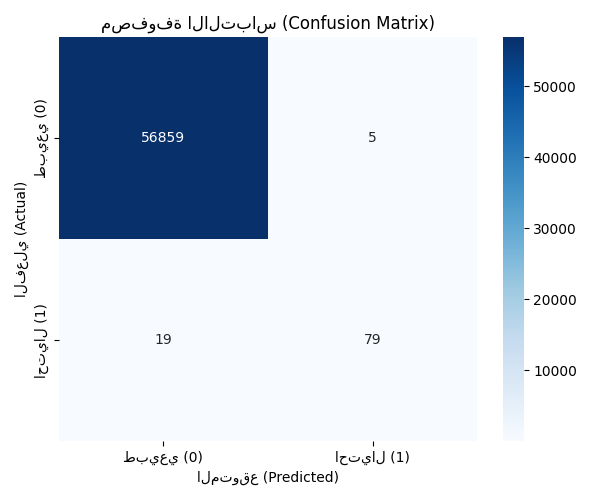
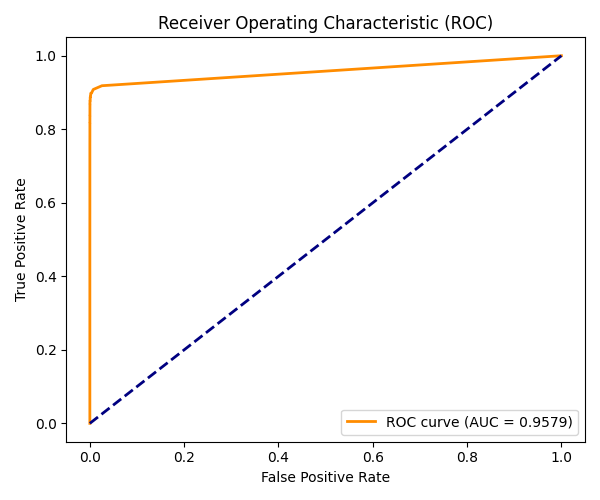
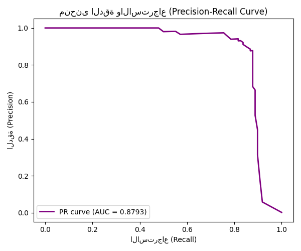
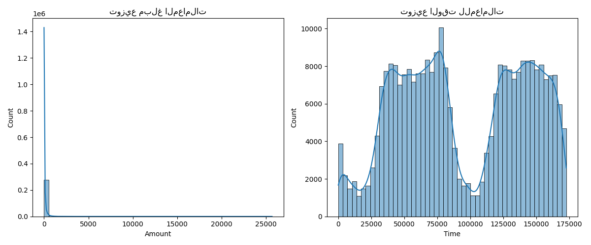
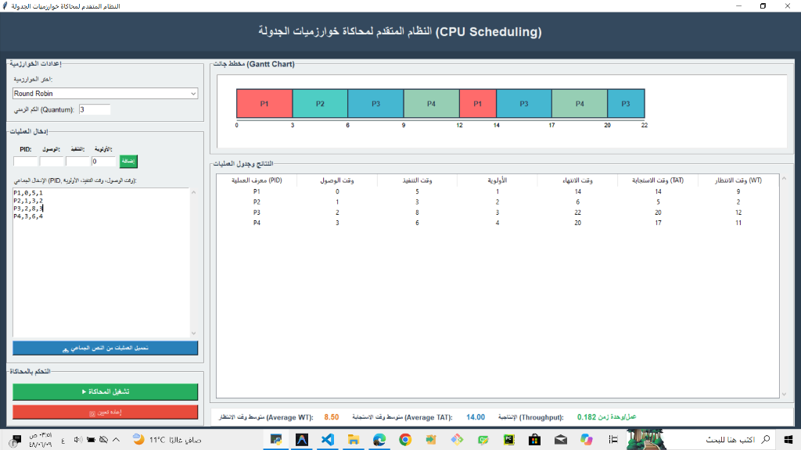

<div align="center">

# 🛡️ AI Fraud Detection & CPU Scheduling Simulator ⚡
### نظام ذكي لكشف الاحتيال المالي ومحاكي متقدم لخوارزميات جدولة المعالج

[](https://www.python.org/)
[](https://scikit-learn.org/)
[](https://pandas.pydata.org/)
[](https://docs.python.org/3/library/tkinter.html)
[](LICENSE)

<p align="center">
  <b>مشروع متكامل يجمع بين قوة الذكاء الاصطناعي في كشف الاحتيال البنكي وأنظمة التشغيل ومحاكاة خوارزميات الجدولة</b>
  <br />
  <i>An end-to-end Machine Learning Fraud Detection System with interactive Desktop GUIs and an Advanced CPU Scheduling Simulator.</i>
</p>

</div>

---

## 📑 جدول المحتويات (Table of Contents)
- [🌟 نظرة عامة على المشروع (Project Overview)](#-نظرة-عامة-على-المشروع-project-overview)
- [🛡️ القسم الأول: نظام كشف الاحتيال المالي (AI Fraud Detection)](#️-القسم-الأول-نظام-كشف-الاحتيال-المالي-ai-fraud-detection)
  - [الميزات الرئيسية](#الميزات-الرئيسية)
  - [لوحة التحكم الرسومية (GUI Dashboard)](#لوحة-التحكم-الرسومية-gui-dashboard)
  - [مقاييس الأداء والنتائج (Performance & Evaluation)](#مقاييس-الأداء-والنتائج-performance--evaluation)
  - [معرض الرسوم والمخططات البيانية](#معرض-الرسوم-والمخططات-البيانية)
- [⚡ القسم الثاني: محاكي خوارزميات جدولة المعالج (CPU Scheduling Simulator)](#-القسم-الثاني-محاكي-خوارزميات-جدولة-المعالج-cpu-scheduling-simulator)
  - [الخوارزميات المدعومة](#الخوارزميات-المدعومة)
  - [مخطط جانت الحي والنتائج](#مخطط-جانت-الحي-والنتائج)
- [📁 هيكل المستودع (Repository Structure)](#-هيكل-المستودع-repository-structure)
- [🚀 التثبيت والتشغيل السريع (Getting Started)](#-التثبيت-والتشغيل-السريع-getting-started)
- [📊 بيانات المعاملات (Dataset Information)](#-بيانات-المعاملات-dataset-information)
- [👤 المؤلف ورخصة الاستخدام (Author & License)](#-المؤلف-ورخصة-الاستخدام-author--license)

---

## 🌟 نظرة عامة على المشروع (Project Overview)

تم بناء هذا المشروع لتقديم حلين برمجيين متقدمين:
1. **نظام تعلم آلي (Machine Learning)** عالي الدقة مبني على خوارزمية **Random Forest Classifier** لاكتشاف المعاملات الاحتيالية في بطاقات الائتمان والتعامل مع مشكلة عدم توازن البيانات (Imbalanced Data).
2. **محاكي رسومي تفاعلي (Interactive Simulator)** لأنظمة التشغيل لتنفيذ ومقارنة خوارزميات جدولة العمليات في المعالج (CPU Scheduling) ورسم مخطط جانت الزمني وحساب الأداء بدقة رياضية متناهية.

---

## 🛡️ القسم الأول: نظام كشف الاحتيال المالي (AI Fraud Detection)

### الميزات الرئيسية
* **نموذج مدرب جاهز للإنتاج:** تم تدريب وضبط نموذج `RandomForestClassifier` مع موازنة الفئات (`class_weight='balanced'`) للتعامل مع ندرة حالات الاحتيال (0.17%).
* **معالجة مسبقة ذكية (Preprocessing):** تقسيم البيانات بنظام `Stratified Split` وتوحيد المقاييس باستخدام `StandardScaler`.
* **سرعة الاستجابة:** نظام خفيف وسريع يفحص أي معاملة ويعطي نسبة الاحتمالية في أجزاء من الثانية.

### لوحة التحكم الرسومية (GUI Dashboard)
تم تزويد المشروع بواجهة رسومية شاملة عبر الملف [`main.py`](main.py):
* **فحص المعاملات الحية:** إدخال مخصص لجميع المتغيرات الثلاثين (Time, Amount, V1-V28).
* **اختبار سريع بنقرة واحدة:** أزرار مخصصة لتحميل عينات احتيالية حقيقية أو طبيعية ومقارنة توقع النموذج مع القيمة الفعلية.
* **عرض مرئي للنتائج:** بطاقة نتيجة ملونة توضح درجة الخطورة ونسبة احتمالية الاحتيال بدقة.
* **إعادة التدريب المباشر:** إمكانية إعادة تدريب النموذج في خيط خلفي (Background Thread) دون تجميد الواجهة.

```powershell
python main.py
```

### مقاييس الأداء والنتائج (Performance & Evaluation)
تم اختبار النموذج على **56,962** معاملة مالية لم يشهدها أثناء التدريب، وحقق النتائج التالية:

| المقياس (Metric) | النتيجة (Score) | الوصف الأكاديمي |
| :--- | :---: | :--- |
| **الدقة العامة (Accuracy)** | **99.95%** | النسبة الإجمالية للتوقعات الصحيحة |
| **دقة كشف الاحتيال (Precision)** | **94.05%** | عند التنبؤ بوجود احتيال، يكون النموذج محقاً بنسبة 94% |
| **معدل الاسترجاع (Recall)** | **80.61%** | قدرة النموذج على رصد 81% من إجمالي عمليات الاحتيال الفعلية |
| **مقياس F1-Score** | **0.87** | التوازن التوافقي بين الدقة ومعدل الاسترجاع |
| **مساحة منحنى ROC (AUC)** | **0.97** | قدرة استثنائية على التمييز بين المعاملات الطبيعية والاحتيالية |

### معرض الرسوم والمخططات البيانية

<div align="center">

| مصفوفة الالتباس (Confusion Matrix) | منحنى خصائص التشغيل (ROC Curve) |
| :---: | :---: |
|  |  |

| منحنى الدقة والاسترجاع (Precision-Recall) | توزيع مبالغ ووقت المعاملات |
| :---: | :---: |
|  |  |

</div>

---

## ⚡ القسم الثاني: محاكي خوارزميات جدولة المعالج (CPU Scheduling Simulator)

محاكي مكتبي تفاعلي متقدم مصمم لدراسة وتحليل خوارزميات إدارة العمليات في أنظمة التشغيل عبر واجهة رسومية سهلة واستجابة فورية عبر الملف [`nabil.py`](nabil.py).

### الخوارزميات المدعومة
1. **Round Robin (RR):** مع إمكانية تعديل الكم الزمني (Time Quantum) بحرية.
2. **First-Come, First-Served (FCFS):** الأسبقية لمن يصل أولاً.
3. **Shortest Job First (SJF - Non-Preemptive):** العملية الأقصر تنفيذاً أولاً.
4. **Priority Scheduling (Non-Preemptive):** الجدولة القائمة على الأولوية.
5. **Shortest Remaining Time First (SRTF):** الجدولة الاستباقية للوقت المتبقي الأقصر.

### مخطط جانت الحي والنتائج
يولد التطبيق مخطط جانت ملوناً بدقة بالغة ويوضح تقسيم الشرائح الزمنية مع حساب تلقائي لكل من:
* **وقت الانتهاء (Completion Time)**
* **وقت الاستجابة (Turnaround Time - TAT)**
* **وقت الانتظار (Waiting Time - WT)**
* **الإنتاجية (Throughput)** ومعدلات الانتظار الإجمالية.

<div align="center">
  
</div>

تشغيل المحاكي:
```powershell
python nabil.py
```

---

## 📁 هيكل المستودع (Repository Structure)

```text
├── main.py                     # لوحة التحكم الرسومية لكشف الاحتيال المالي (GUI Dashboard)
├── nabil.py                    # النظام المتقدم لمحاكاة خوارزميات الجدولة (Desktop GUI)
├── requirements.txt            # قائمة الاعتمادات والمكتبات البرمجية المطلوبة
├── .gitignore                  # الملفات المستثناة من التتبع (البيانات الكبيرة والبيئة الافتراضية)
├── README.md                   # التوثيق الشامل والرسمي للمشروع
│
├── data/                       # مجلد البيانات
│   ├── .gitkeep               # الحفاظ على بنية المجلد في Git
│   └── samples_for_gui.csv    # عينات حقيقية خفيفة وسريعة لاختبار الواجهة فوراً
│
├── models/                     # مجلد حفظ النماذج المدربة
│   ├── trained_model.pkl      # نموذج Random Forest المدرب والجاهز للاستخدام
│   └── scaler.pkl             # أداة تسوية المقاييس (StandardScaler) المحفوظة
│
├── results/                    # مخرجات التقييم والمخططات البيانية
│   ├── confusion_matrix.png   # رسم مصفوفة الالتباس
│   ├── roc_curve.png          # رسم منحنى ROC
│   ├── precision_recall_curve.png # رسم منحنى PR
│   ├── class_distribution.png # توزيع الفئات
│   ├── amount_time_distribution.png # توزيع المبالغ والأوقات
│   └── cpu_scheduling_gui.png # لقطة شاشة لمحاكي الجدولة
│
├── round_robin/                # وحدة محاكاة خوارزمية Round Robin المنفصلة
│   └── round_robin.py         # تطبيق Tkinter مستقل لخوارزمية Round Robin
│
└── src/                        # الأكواد المصدرية لمشروع التعلم الآلي
    ├── preprocess.py          # تحميل ومعالجة وتقسيم البيانات
    ├── train_model.py         # تدريب النموذج وتصديره
    ├── evaluate.py            # تقييم النموذج وتوليد التقارير والمخططات
    ├── fraud_eda_preprocess.py # الاستكشاف والتحليل الإحصائي
    └── fraud_detection_analysis.py # تحليل مصفوفة الارتباط وتوزيع المتغيرات
```

---

## 🚀 التثبيت والتشغيل السريع (Getting Started)

### 1. استنساخ المستودع (Clone Repository)
```bash
git clone https://github.com/mushtaqalfaqih/Fraud-Detection-and-CPU-Scheduling.git
cd Fraud-Detection-and-CPU-Scheduling
```

### 2. إعداد البيئة الافتراضية وتثبيت المتطلبات
```bash
# إنشاء بيئة افتراضية
python -m venv .venv

# تفعيل البيئة على Windows (PowerShell)
.\.venv\Scripts\Activate.ps1

# تثبيت الحزم المطلوبة
pip install -r requirements.txt
```

### 3. تشغيل الواجهات الرسومية مباشرة
* **لتشغيل نظام كشف الاحتيال:**
  ```bash
  python main.py
  ```
* **لتشغيل محاكي جدولة المعالج:**
  ```bash
  python nabil.py
  ```

### 4. تشغيل مراحل التعلم الآلي عبر سطر الأوامر (CLI Pipeline)
```bash
# استكشاف البيانات
python src/fraud_eda_preprocess.py

# تدريب النموذج
python src/train_model.py

# تقييم النموذج وتوليد الرسوم البيانية
python src/evaluate.py
```

---

## 📊 بيانات المعاملات (Dataset Information)

يستخدم المشروع بيانات معاملات البطاقات الائتمانية العالمية الشهيرة:
* **المصدر:** [Kaggle - Credit Card Fraud Detection Dataset](https://www.kaggle.com/datasets/mlg-ulb/creditcardfraud).
* **إجمالي المعاملات:** 284,807 معاملة مالية.
* **الميزات:** 30 ميزة تشمل الوقت والمبلغ بالإضافة إلى 28 ميزة مستخرجة عبر تحليل المكونات الرئيسية (PCA).
* **الملف الأصلي:** ملف `creditcard.csv` (بحجم ~150MB) مستثنى من مستودع GitHub وفقاً لسياسات الأحجام، بينما يحتوي المستودع على عينات حقيقية مدمجة [`data/samples_for_gui.csv`](data/samples_for_gui.csv) ليعمل النموذج والواجهة فوراً دون الحاجة لإعادة تحميل الملف الكبير.

---

## 👤 المؤلف ورخصة الاستخدام (Author & License)

* **المطور:** [mushtaqalfaqih](https://github.com/mushtaqalfaqih)
* **المستودع:** [Fraud-Detection-and-CPU-Scheduling](https://github.com/mushtaqalfaqih/Fraud-Detection-and-CPU-Scheduling)
* **الرخصة:** مرخص تحت رخصة **MIT License** المفتوحة للمطورين والباحثين.

<div align="center">
  <sub>تم التطوير والتنظيم بأعلى معايير جودة وهندسة البرمجيات 🚀</sub>
</div>
